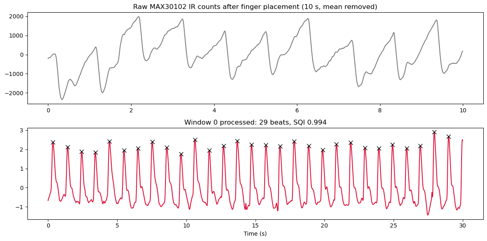
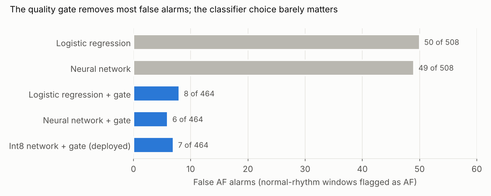
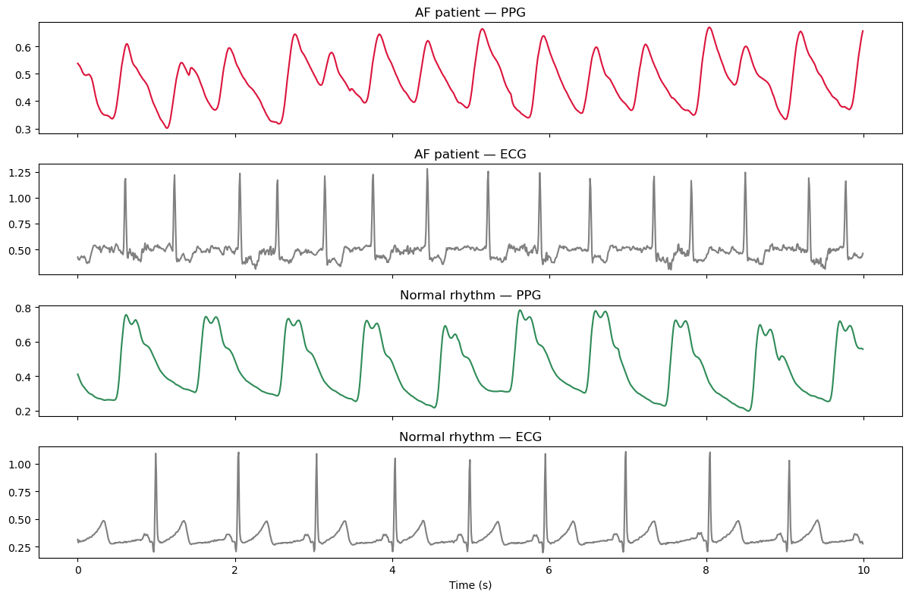
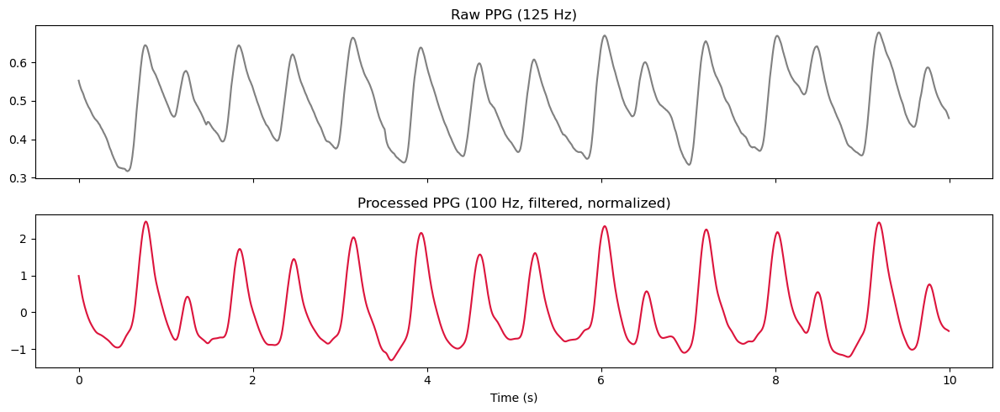
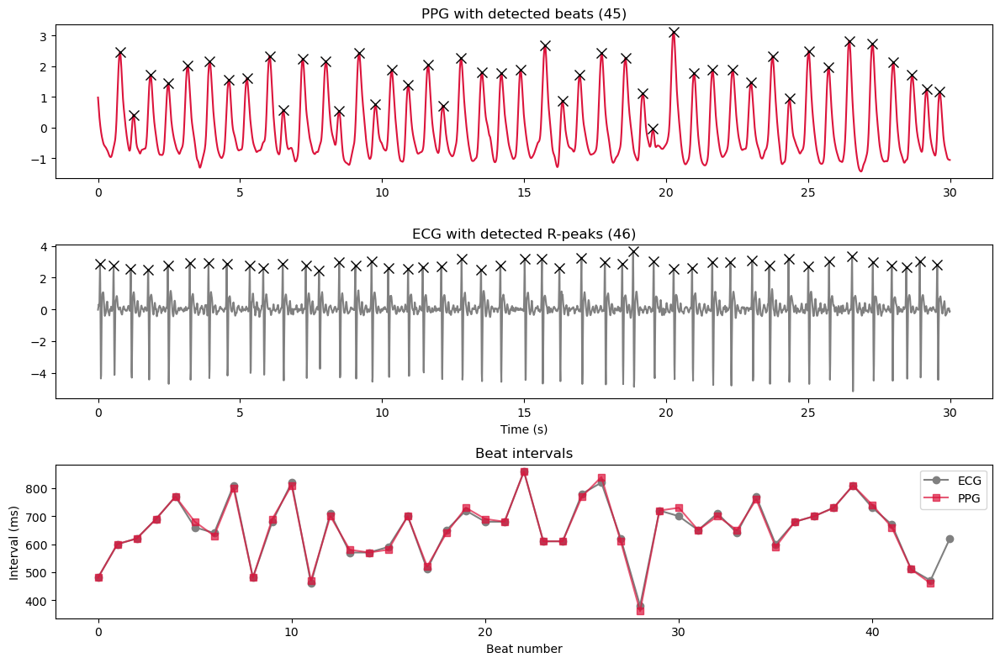
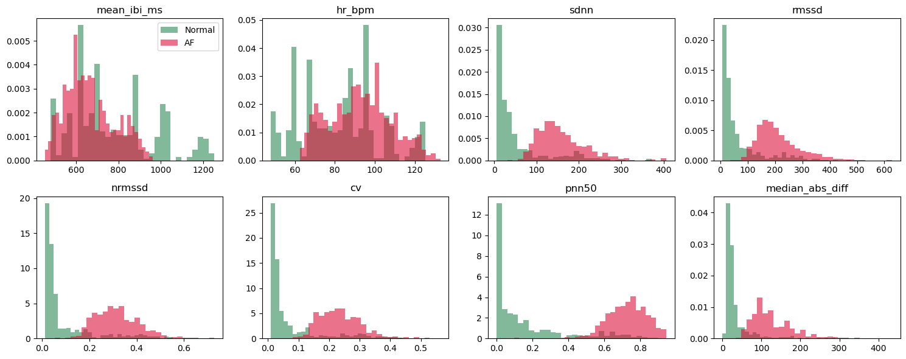
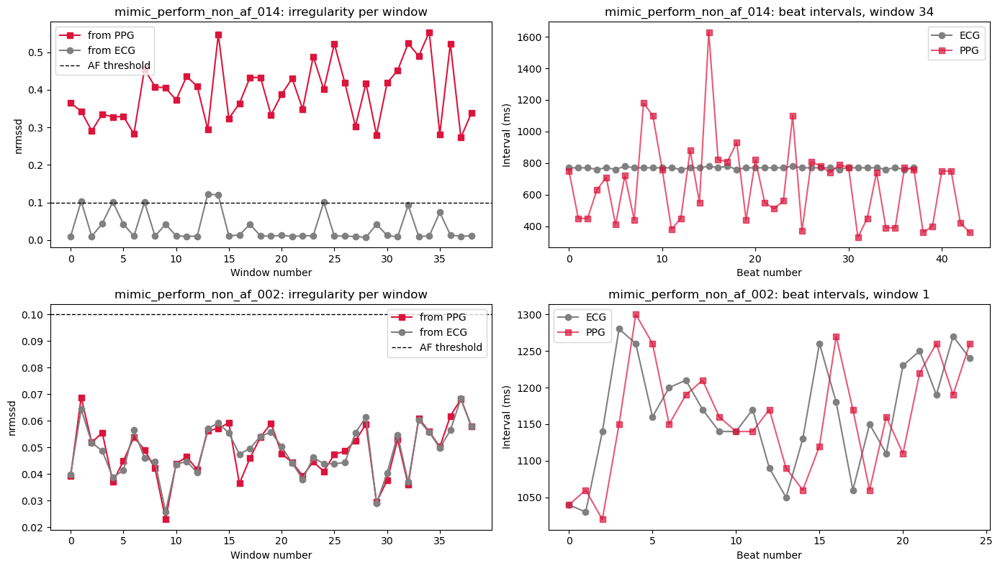
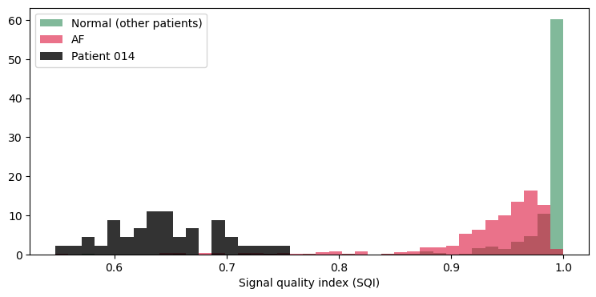
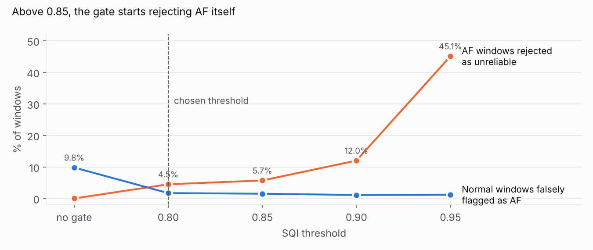

# Signal-Quality-Aware Atrial Fibrillation Screening on a Microcontroller

On-device atrial fibrillation (AF) screening from photoplethysmography (PPG). A low-cost **MAX30102** optical sensor feeds a signal-processing pipeline, a **signal-quality gate** and a 2.8 KB **int8 neural network**, all running on an **Arduino Nano 33 BLE Sense** (Nordic nRF52840, Arm Cortex-M4F, 64 MHz) under **Zephyr RTOS** with TensorFlow Lite Micro, without the Arduino framework.

Every 30 seconds of pulse, the device reports **normal**, **possible AF** or **unreliable signal**, with heart rate and signal quality.


*Live screening: finger on the MAX30102, result printed over serial. [Full video ↓](#live-screening-video)*


*A live recording from the MAX30102: raw pulse (top) and one 30 s window after processing, with every beat detected (bottom, 29 beats, SQI 0.994).*

## Key results

| | Result |
|---|---|
| False AF alarms, classifier only → with quality gate | **49 → 7** (86% fewer), on patients unseen in training and tuning |
| Sensitivity / specificity, deployed int8 model + gate | **0.985 / 0.985** (AUC 0.998) |
| int8 vs. float32 | same decision on **99.91%** of held-out windows |
| Model size / working memory | **2,848 bytes** / ~1 KB |
| Analysis of one 30 s window on the nRF52840 | **11.9 ms** (filter, beat detection, quality gate, features, model) |
| On-device output vs. Python reference | identical on all test windows |
| Live MAX30102 test (one healthy subject) | 7 windows: 4 normal, 3 rejected as unreliable, **0 false AF alarms** |



## Contents

1. [Dataset](#dataset)
2. [Approach](#approach)
3. [Exploring the data](#1-exploring-the-data)
4. [Signal processing and beat detection](#2-signal-processing-and-beat-detection)
5. [Rhythm features](#3-rhythm-features)
6. [Classification and the false-alarm problem](#4-classification-and-the-false-alarm-problem)
7. [The signal-quality gate](#5-the-signal-quality-gate)
8. [Neural network and int8 quantization](#6-neural-network-and-int8-quantization)
9. [On-device implementation](#7-on-device-implementation)
10. [Live MAX30102 results](#8-live-max30102-results)
11. [Limitations](#limitations)

## Dataset

[MIMIC PERform AF](https://ppg-beats.readthedocs.io/en/latest/datasets/mimic_perform_af/): 20-minute PPG and ECG recordings from 35 critically ill adults (19 in AF, 16 in normal rhythm), sampled at 125 Hz, mostly fingertip PPG, with AF labels from cardiologists. After windowing, **32 patients** had usable recordings, giving **1,157 windows of 30 s** (649 AF, 508 normal).

> Charlton PH et al. *Detecting beats in the photoplethysmogram: benchmarking open-source algorithms.* Physiological Measurement, 2022. DOI: [10.1088/1361-6579/ac826d](https://doi.org/10.1088/1361-6579/ac826d)

## Approach

```
PPG (MAX30102 IR, 100 Hz)
  → invert, remove DC level
  → causal Butterworth band-pass 0.5–8 Hz
  → 30 s windows, z-score
  → beat detection (distance 0.33 s, prominence 0.5)
  → quality gate: template-matching SQI ≥ 0.80, else "unreliable signal"
  → rhythm features: nrmssd, cv, pnn_rel, mad_rel (all normalised by heart rate)
  → int8 network: Normalization → Dense(16, ReLU) → Dense(1, sigmoid)
  → normal / possible AF
```

The model sees **beat timing, not waveform shape**. AF is defined by irregular timing, which looks the same on a hospital monitor and on a low-cost sensor, so a model trained on clinical data can transfer to new hardware.

## 1. Exploring the data



In **normal rhythm**, beats are evenly spaced and of similar height; the ECG shows a P wave before each beat. In **AF**, beats arrive at irregular intervals, the ECG has no clear P waves, and PPG pulse heights vary from beat to beat, because after a short interval the heart has less time to fill.

## 2. Signal processing and beat detection



The clinical data is processed the way the device will see it: resampled from 125 Hz to 100 Hz (the MAX30102's rate), band-pass filtered at 0.5–8 Hz with a **causal** filter (one the microcontroller can apply in real time), cut into 30 s windows and normalised.



PPG beats were validated against ECG R-peaks. In this AF window the detector caught every pulse, including the weak beats that follow short intervals, and **PPG beat intervals track ECG intervals closely**, even through jumps from 860 ms to 370 ms. (The ECG shows one more beat because the last pulse had not reached the finger before the window ended.)

## 3. Rhythm features



**Heart rate does not separate AF from normal rhythm** in this dataset (`mean_ibi_ms` and `hr_bpm` overlap heavily), so a model cannot take the "fast heart = AF" shortcut. **Beat-to-beat variability separates them well** (`sdnn`, `rmssd`, `nrmssd`, `cv`, `pnn50`).

## 4. Classification and the false-alarm problem

All evaluation is **patient-wise**: no patient appears in both training and test data.

| Features | Sensitivity | Specificity | AUC | False alarms |
|---|---|---|---|---|
| nrmssd, cv, pnn50, median_abs_diff | 0.985 | 0.852 | 0.908 | 75 / 508 |
| **All normalised by heart rate** (nrmssd, cv, pnn_rel, mad_rel) | 0.983 | **0.902** | **0.939** | **50 / 508** |

The false alarms were concentrated in two normal-rhythm patients, with two different causes:



- **Patient 014: a poor PPG signal (top).** The ECG intervals (grey) stay flat at ~770 ms, but the PPG detector double-counts beats (intervals near half of 770 ms) and misses others (near double). PPG irregularity was above the AF threshold in **39 of 39** windows; ECG irregularity in only **6 of 39**. A regular heart was misread purely because of signal quality.
- **Patient 002: a feature design flaw (bottom).** PPG and ECG agree, and the rhythm is normal. At a slow heart rate (~1,150 ms intervals), normal variation exceeds 50 ms, so the absolute-millisecond features looked like AF. Normalising every feature by heart rate cut this patient's false alarms from **23 to 2**.

After this fix, **patient 014 alone produced 39 of the remaining 50 false alarms (78%)**.

## 5. The signal-quality gate

The gate must work from the PPG alone, since the device has no ECG. Each beat is cut out around its peak, all beats are averaged into a template, and the **SQI is the mean correlation of each beat with the template**. When the detector double-counts or misses beats, the cut-out segments are misaligned and SQI drops.



Patient 014 (black) sits at SQI 0.55–0.75, well apart from everyone else. Normal windows cluster near 1.0. **AF windows spread from about 0.85 to 1.0**, because AF itself changes pulse shape.



| SQI threshold | Sensitivity | Specificity | False alarms | AF windows rejected | Normal windows rejected |
|---|---|---|---|---|---|
| none | 0.983 | 0.902 | 50 | 0.0% | 0.0% |
| 0.80 | 0.982 | 0.983 | 8 | 4.5% | 8.7% |
| 0.85 | 0.982 | 0.985 | 7 | 5.7% | 9.1% |
| 0.90 | 0.984 | 0.989 | 5 | 12.0% | 10.6% |
| 0.95 | 0.992 | 0.988 | 5 | 45.1% | 15.7% |

For an **unbiased** estimate, the threshold was chosen inside each cross-validation fold using only training patients (the highest threshold rejecting ≤ 5% of training AF windows). The chosen thresholds were stable across folds (0.794, 0.877, 0.838, 0.798, 0.794).

| On unseen patients | Sensitivity | Specificity | AUC | False alarms | AF rejected |
|---|---|---|---|---|---|
| No gate | 0.983 | 0.902 | 0.939 | 50 / 508 | — |
| **With quality gate** | **0.982** | **0.983** | **0.998** | **8 / 464** | 5.4% |

## 6. Neural network and int8 quantization

A small neural network and logistic regression were each tuned with a **nested grid search** (outer 5-fold and inner 3-fold patient-wise cross-validation), so hyperparameters were never chosen on test patients. A learning rate of 0.01 won in every fold, and one hidden layer in four of five.

| Model (patients unseen in training and tuning) | Sensitivity | Specificity | AUC | False alarms |
|---|---|---|---|---|
| Logistic regression | 0.975 | 0.902 | 0.942 | 50 / 508 |
| Neural network | 0.980 | 0.904 | 0.955 | 49 / 508 |
| Logistic regression + gate | 0.979 | 0.983 | 0.997 | 8 / 464 |
| Neural network + gate | 0.984 | 0.987 | 0.997 | 6 / 464 |
| **Int8 network + gate (deployed)** | **0.985** | **0.985** | **0.998** | **7 / 464** |

The tuned network performs on par with logistic regression: **the quality gate, not the classifier, accounts for nearly all of the improvement.** The network (16 hidden units, 106 parameters) was deployed because it fits the TensorFlow Lite Micro toolchain.

**Quantization:** float and int8 models give the same decision on 99.91% of held-out windows; on the final model, the mean probability difference is 0.0022.

**A bug found along the way:** the first conversion calibrated int8 ranges on the first 500 windows, which were all AF because of dataset ordering. Normal windows fell outside the calibrated ranges and were clipped, so 466 of 1,157 windows produced the same output (p = 0.40). Decisions were mostly still correct, which hid the bug in a decision-only comparison. Calibrating on both classes fixed it, after which the most common output was −128, i.e. confidently normal.

## 7. On-device implementation

Everything runs on the nRF52840 under Zephyr RTOS:

| Component | Implementation |
|---|---|
| Sensor | Own MAX30102 driver on Zephyr's I²C API; devicetree overlay; SpO₂ mode, 400 Hz with 4-sample averaging → 100 Hz; LED current 0x30 (~9.6 mA) |
| Acquisition | High-priority thread reading the sensor FIFO into a queue; processing runs at lower priority, so acquiring samples always preempts analysing them |
| Signal processing | C port of the Python pipeline; beat detection reproduces `scipy.signal.find_peaks` exactly (local maxima → distance rule → prominence rule, in scipy's order) |
| Model | TensorFlow Lite Micro with CMSIS-NN kernels; only the 4 required operations compiled in |
| Session logic | Measurement starts after 1 s of finger contact plus 3 s settling, restarts when the finger is lifted, and discards any measurement in which a sample is lost |

The firmware was verified in three stages, each against Python outputs.

**Stage 1: the model alone.** 20 golden feature vectors, including the 4 closest to the decision boundary:
```
Model: 2848 bytes | arena used: 1028 of 8192 bytes
Exact match 20/20 | within 1 step 20/20 | same decision 20/20
Average inference time: 272 us
RESULT: PASS
```

**Stage 2: the signal processing on a PC.** The C code was checked against Python on 120 synthetic windows (normal, AF, ectopic beats, heavy noise, weak signal): **zero mismatches** in beat count or gate decision; largest differences SQI 1.6 × 10⁻⁶, features 5.4 × 10⁻⁷.

**Stage 3: the full pipeline on the board.** Two raw-signal segments streamed sample by sample through the same code the live sensor uses: a MAX30102 recording, and a real MIMIC AF patient converted to MAX30102-style counts.
```
Your MAX30102 recording (true rhythm: normal)
 win beats   SQI     HR  model  board result       python
  0    29   0.994   58.7  -128   normal             normal OK
  1    29   0.996   59.7  -127   normal             normal OK
  2    30   0.993   60.3  -127   normal             normal OK

MIMIC mimic_perform_af_001 at 60 s (true rhythm: AF)
 win beats   SQI     HR  model  board result       python
  0    45   0.957   91.1   127   possible AF        possible AF OK
  1    46   0.925   93.3   125   possible AF        possible AF OK
  2    46   0.976   92.0   127   possible AF        possible AF OK

Windows matching Python: 6/6
Largest difference: SQI 4.17e-07, features 2.98e-08
Time to analyse one 30 s window (DSP + model): 11880 us
RESULT: PASS
```
11.9 ms per 30 s window means the processor is busy about **0.04% of the time**.

## 8. Live MAX30102 results

**Streaming:** after fixing the wiring, a 2-minute capture ran at **99.8 Hz with 0 lost samples, 0 FIFO overflows and 0 I²C errors**.

**Recording through the pipeline (PC analysis, one healthy subject at rest):**

| Window | SQI | HR (bpm) | nrmssd | cv | pnn_rel | mad_rel | p(AF) | Result |
|---|---|---|---|---|---|---|---|---|
| 0 | 0.994 | 58.7 | 0.027 | 0.019 | 0.000 | 0.029 | 0.000 | normal |
| 1 | 0.996 | 59.7 | 0.042 | 0.030 | 0.111 | 0.040 | 0.004 | normal |
| 2 | 0.993 | 60.3 | 0.045 | 0.041 | 0.107 | 0.035 | 0.004 | normal |

The features fall in the same range as the normal-rhythm patients in the clinical training data: **a model trained on hospital monitors gives correct, confident output on a low-cost sensor.**

**Live screening on the board** (finger placed and lifted between windows, so each session gave one window):

<a id="live-screening-video"></a>

https://github.com/user-attachments/assets/REPLACE-WITH-YOUR-VIDEO-LINK

| Session | Result | HR (bpm) | SQI | p(AF) | Processing time |
|---|---|---|---|---|---|
| 1 | normal | 85 | 0.90 | 0.02 | 12.1 ms |
| 2 | normal | 74 | 0.90 | 0.05 | 11.7 ms |
| 3 | unreliable signal (40 beats) | – | 0.62 | – | – |
| 4 | normal | 79 | 0.82 | 0.02 | 11.9 ms |
| 5 | unreliable signal (42 beats) | – | 0.67 | – | – |
| 6 | unreliable signal (40 beats) | – | 0.76 | – | – |
| 7 | **normal** | **65** | **0.98** | **0.00** | 10.5 ms |

```
[02:24] Measuring. First result in about 32 s.
[02:56] Window 0: normal | HR 65 bpm | SQI 0.98 | p(AF) 0.00 | 10459 us
[02:59] Finger lifted. Place your finger to start again.
```

**Summary:** 7 live windows, 4 normal, 3 rejected as unreliable, **0 false AF alarms**.

- **Session 3 lost data:** about 30 s of samples were lost to I²C errors while the finger was repeatedly placed and lifted, flexing the wiring. The gate rejected the window. The firmware now discards any measurement with lost samples; sessions 4–7 lost none.
- **Signal quality varied between placements** (SQI 0.62–0.98). The cleanest window gave 65 bpm, consistent with the resting recording (58.7–60.3 bpm). Lower-quality windows gave higher heart rates or about 40 beats per 30 s, which suggests the detector over-counts secondary pulse peaks on weaker signals. This was not checked against a manual pulse count.
- **The rhythm call stayed safe, but the heart rate did not always:** windows at SQI 0.82–0.90 passed with a correct "normal" call but a possibly inflated heart rate.

### What it took to get a clean signal

| | First attempts | Final recording |
|---|---|---|
| Pulse size | ~300–400 counts | ~3,000–4,000 counts |
| Beats detected (30 s) | 46–48 (false beats on noise) | 29 (every beat) |
| SQI | 0.69–0.75 (rejected) | 0.994 |

- **Wiring:** I²C through a shield and loose Grove connectors caused I²C errors and lost samples; short direct wiring fixed it.
- **Ambient light:** room-light flicker added noise, removed by covering the sensor.
- **LED current and finger pressure:** raising the LED current from 0x24 (~7.2 mA) to 0x30 (~9.6 mA), together with a light, centred touch, gave a roughly tenfold stronger pulse.
- **Filter start-up:** raw counts sit near 100,000, so the DC level is removed before filtering, and analysis waits until the finger has settled; otherwise the filter transient creates false beats.

## Hardware

| MAX30102 (MH-ET LIVE module) | Nano 33 BLE Sense |
|---|---|
| VIN | 3V3 |
| GND | GND |
| SDA | A4 |
| SCL | A5 |
| INT | D2 |

## Repository layout

```
notebooks/01_explore.ipynb    exploration, features, training, quantization, exports
firmware/af_firmware/         stage 1: model-only test against golden feature vectors
firmware/max30102_stream/     MAX30102 driver, raw streaming over USB
  tools/capture.py            record the stream to CSV
  tools/live_view.py          live pulse view for finger placement
firmware/af_pipeline/         stage 3: full pipeline against golden raw-signal data
firmware/af_live/             live AF screening
images/                       figures and demo GIF used in this README
```

## Building

Requires a [Zephyr](https://docs.zephyrproject.org/latest/develop/getting_started/index.html) workspace with TensorFlow Lite Micro enabled:

```
west config manifest.project-filter -- +tflite-micro
west update
cd firmware/af_live
west build -p always -b arduino_nano_33_ble/nrf52840/sense
west flash                      # double-tap RESET first
```

Copy `af_model.h` (exported by the notebook) into the firmware's `src/` folder before building.

## Limitations

- **Small clinical dataset:** 32 ICU patients with usable data. Much of the gate's benefit comes from one patient with a poor signal.
- **Per-window statistics:** windows from the same patient are correlated, so uncertainty is larger than window counts suggest.
- **AF on the device** was tested by streaming MIMIC recordings through the pipeline, not with live AF patients. **Live testing so far covers one healthy subject**, with single-window sessions.
- **The quality index penalises AF itself:** irregular beats change pulse shape, so above SQI 0.85 AF windows are rejected at a rapidly increasing rate (45% at 0.95).
- **Heart rate at moderate quality:** at SQI ≈ 0.8–0.9, beat over-counting appears to inflate heart rate even when the rhythm call is correct.
- **Hardware:** the sensor interrupt line is not yet working; acquisition uses a 100 ms timer.
- **Not a medical device.** AF is diagnosed with an ECG.

## Next steps

- More volunteers, continuous multi-window recordings, and recordings with deliberate motion
- Heart-rate validation against a reference (manual count or chest-strap ECG)
- External validation on a larger dataset (MIMIC-III-Ext-PPG) and on wrist PPG
- An AF-aware quality model that separates a noisy signal from an irregular heart
- Accelerometer-based motion detection for the gate
- BLE output and power measurement; custom PCB

## Author

Jeffery Owusu Cobbold · [github.com/JefferyCobbold](https://github.com/JefferyCobbold)
